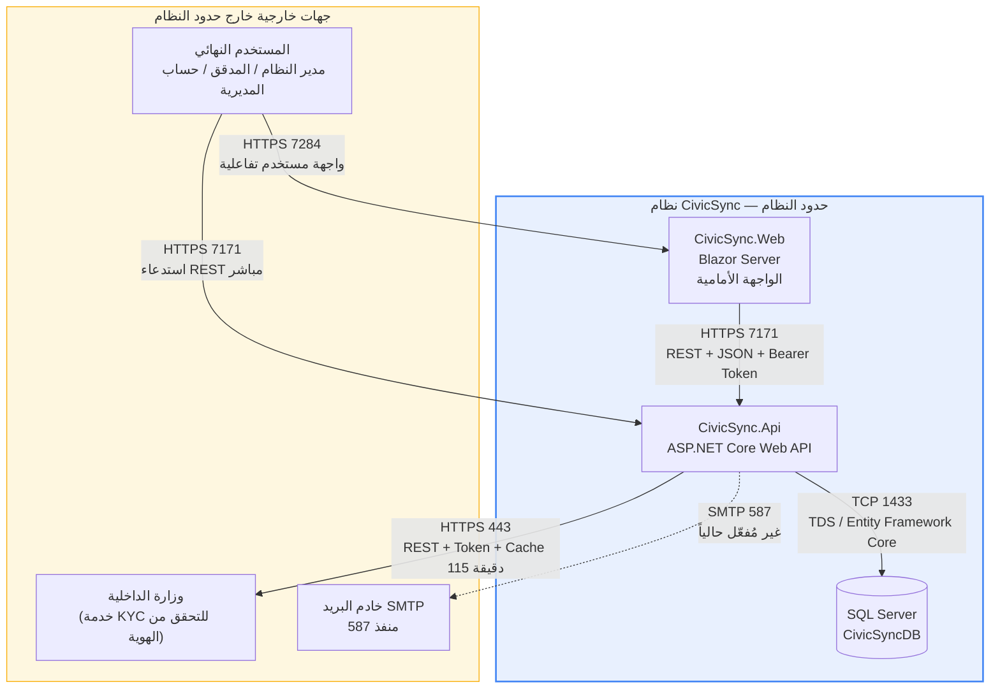
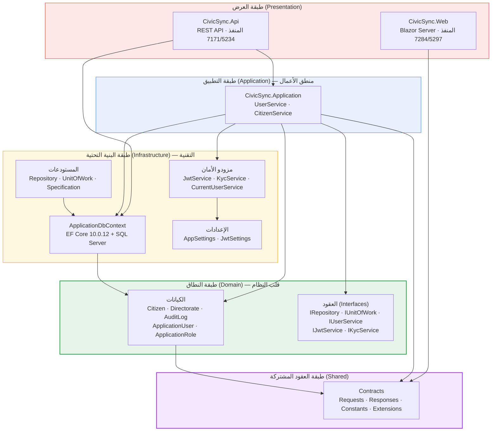
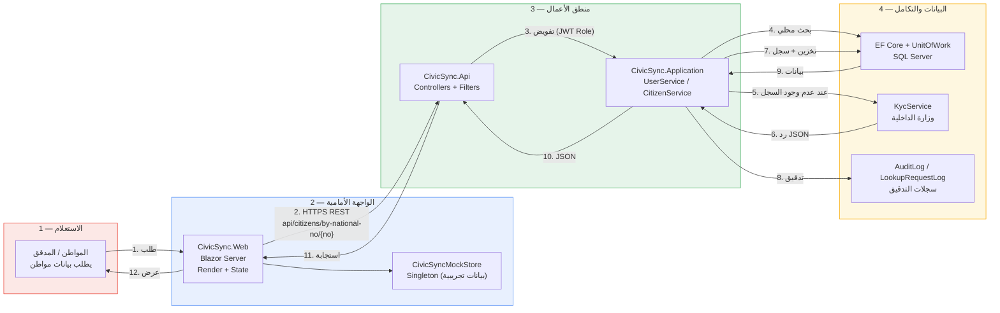
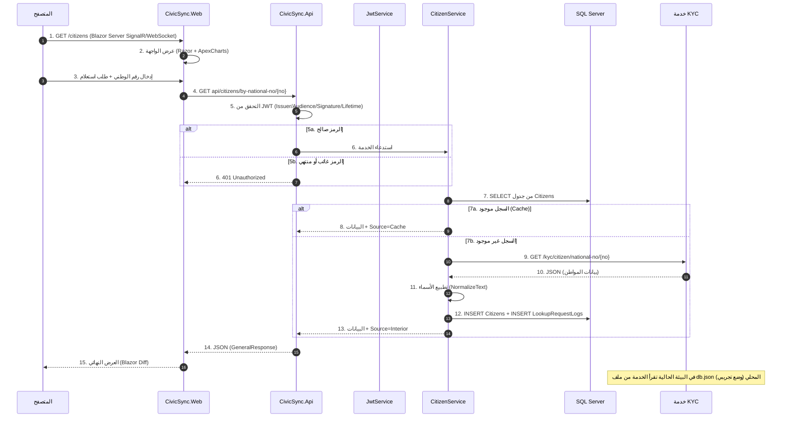
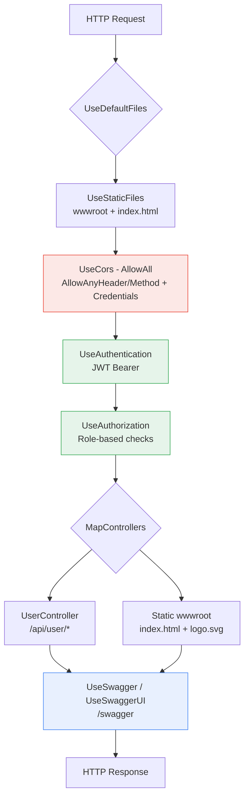
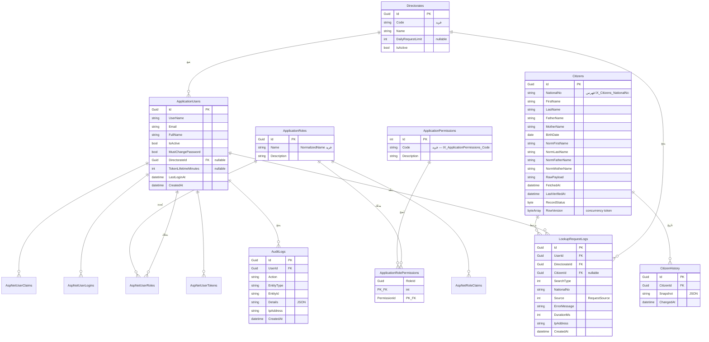
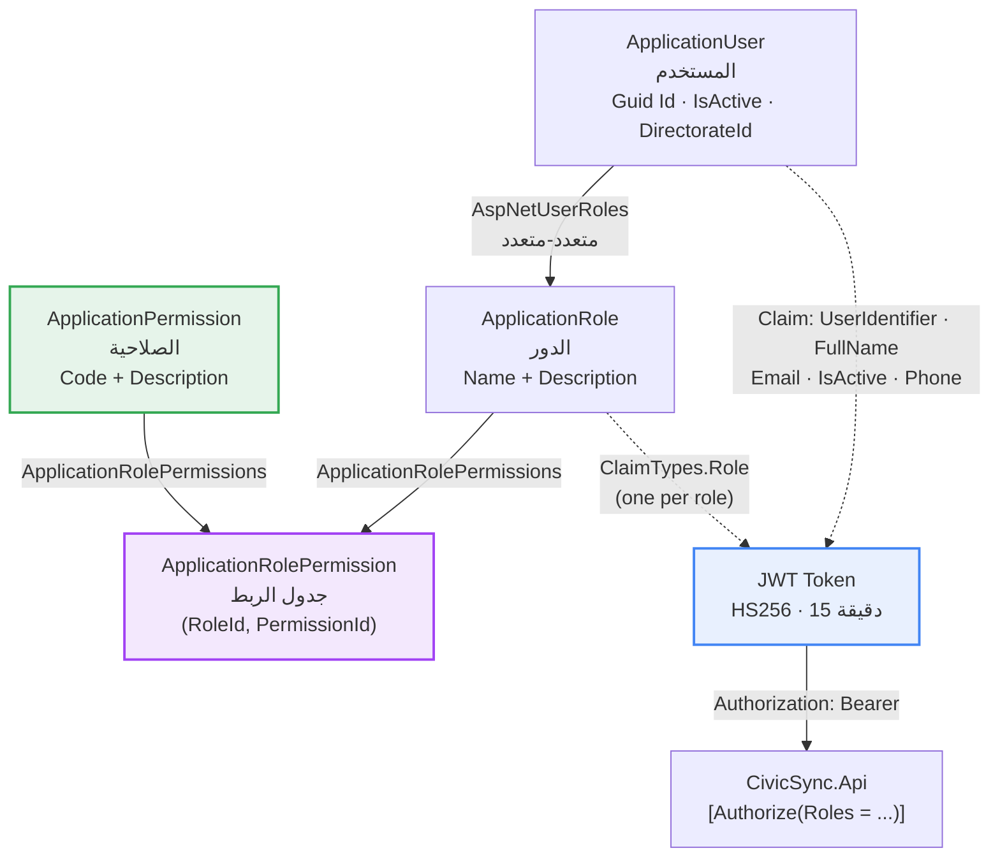
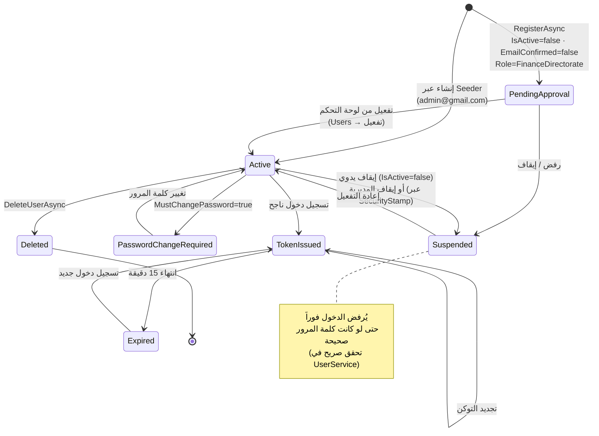
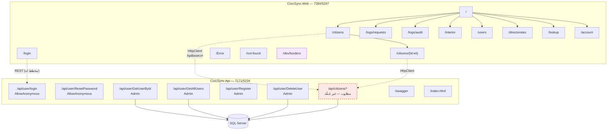

# تقرير طوبولوجيا مشروع CivicSync مع الأدوار والصلاحيات

**التصنيف:** تقرير معماري (Architecture / Topology Report)  
**المشروع:** CivicSync — نظام تنسيق بيانات المواطنين والخدمات الحكومية  
**النطاق:** الخريطة الطوبولوجية الكاملة + نموذج التحكم بالوصول (RBAC)  
**الإصدار:** 1.0  
**التاريخ:** 21 أكتوبر 2026  
**المُعدّ:** مهندس معمارية برمجيات (Software Architect)

---

## 1. ملخص تنفيذي (Executive Summary)

| البند | القيمة |
|-------|--------|
| نمط المعمارية | Clean Architecture / Layered Architecture (6 مشاريع) |
| حزمة تقنية الواجهة الخلفية | ASP.NET Core Web API على .NET 10 (`net10.0`) |
| حزمة تقنية الواجهة الأمامية | Blazor Server (Render Mode: InteractiveServer) على .NET 10 |
| قاعدة البيانات | Microsoft SQL Server — قاعدة `CivicSyncDB` (EF Core 10.0.12) |
| نموذج الهوية | ASP.NET Core Identity + JWT Bearer (HS256) |
| نموذج الصلاحيات | ثلاثي المستويات: مستخدم ← دور ← صلاحية (Role-Based + Permission-Based) |
| عدد الأدوار (Roles) | 3 (Admin, Auditor, FinanceDirectorate) |
| عدد رموز الصلاحيات (Permissions) | 9 رموز |
| نقاط نهاية API (Controllers) | 1 متحكم / 6 مسارات |
| صفحات الواجهة الأمامية | 14 صفحة Razor |
| عدد الجداول في القاعدة | 14 جدولاً |

---

## 2. الطوبولوجيا العامة للنظام (System Topology)

### 2.1 مخطط السياق — حدود النظام (System Context Diagram)

يُظهر هذا المخطط حدود النظام (نظام CivicSync) والجهات الخارجية التي يتفاعل معها.



### 2.2 مخطط الطبقات المعماري واتجاه الاعتمادية (Layered Architecture & Dependency Rule)

يُظهر هذا المخطط قواعد الاعتمادية: **الطبقة الأبعد (Core) لا تعرف شيئاً عن الطبقات الأعلى**.



**قاعدة الاعتمادية (Dependency Rule):**

| المشروع | يستطيع الاعتماد على | لا يعتمد على |
|--------|---------------------|--------------|
| `CivicSync.Shared` | — (لا شيء) | الجميع |
| `CivicSync.Core` | Shared | Infrastructure، Application، Api، Web |
| `CivicSync.Infrastructure` | Core، Shared | Application، Api، Web |
| `CivicSync.Application` | Core، Infrastructure، Shared | Api، Web |
| `CivicSync.Api` | Application، Infrastructure، Core، Shared | — |
| `CivicSync.Web` | Shared | Core، Infrastructure، Application، Api |

> **ملاحظة معمارية:** `CivicSync.Web` لا تقتبس `CivicSync.Application` أو `Infrastructure` — بل تتواصل مع الـ API عبر contracted HTTP فقط، مما يحقق عزلاً كاملاً (Decoupling) للواجهة الأمامية عن منطق الأعمال. هذه نقطة قوة في التصميم وليست ضعفاً.

### 2.3 مخطط تدفق البيانات (Data Flow Diagram — Level 1)



### 2.4 مخطط تسلسل عملية البحث عن مواطن (Sequence Diagram)

يوضح تسلسل الرسائل بين المتصفح والواجهة الأمامية والـ API وقاعدة البيانات وخدمة الداخلية.



### 2.5 مخطط خط أنابيب الطلب في الـ API (Middleware Pipeline)



**ترتيب التهيئة عند الإقلاع (Startup Sequence) في `CivicSync.Api\Program.cs`:**

| الخطوة | الاستدعاء | الأثر |
|--------|-----------|-------|
| 1 | `AddApplicationServices()` | تسجيل `IUserService` و `ICitizenService` (Scoped) |
| 2 | `AddInfrastructureServices(Configuration)` | تسجيل DbContext + Identity + JWT + Cache + SignalR + KycService |
| 3 | `AddApiServices(Configuration)` | تسجيل Controllers + Swagger + CORS + ProblemDetails |
| 4 | `AddControllers().AddJsonOptions(...)` | ضبط `ReferenceHandler.IgnoreCycles` لتفادي الأخطاء المرجعية في JSON |
| 5 | `db.Database.Migrate()` | تطبيق الهجرات تلقائياً على قاعدة البيانات عند الإقلاع |
| 6 | `ApplicationDbSeeder.SeedUsersAsync(userManager)` | بذر حساب المدير الافتراضي |

### 2.6 شجرة مكوّنات الواجهة الأمامية (Blazor Component Tree)

```mermaid
flowchart TD
    App["App.razor<br/>HTML Root · dir=rtl · lang=ar"] --> Routes["Routes.razor<br/>Router + FocusOnNavigate"]

    Routes --> L1["MainLayout.razor<br/>التخطيط الرئيسي"]
    Routes --> L2["EmptyLayout.razor<br/>تخطيط الصفحات العامة"]
    Routes --> L3["NotFound.razor"]

    L1 --> Nav["AppNavbar.razor<br/>شريط التنقل + المستخدم + حالة الداخلية"]
    L1 --> RM["ReconnectModal.razor<br/>نافذة إعادة الاتصال"]

    Nav --> IC["AppIcon.razor<br/>مكتبة الأيقونات"]
    Nav --> SP["StatusPill.razor"]
    Nav --> SC["StatusCard.razor"]
    Nav --> PM["PageHeader.razor"]
    Nav --> ST["StatTile.razor"]
    Nav --> MC["MetricCard.razor"]
    Nav --> GB["GlassCard.razor"]
    Nav --> IB["InfoBlock.razor"]
    Nav --> ES["EmptyState.razor"]
    Nav --> AD["AccessDenied.razor<br/>صفحة منع الوصول"]
    Nav --> RC["RankedBars.razor"]
    Nav --> BC["BarChart.razor"]
    Nav --> DC["DonutChart.razor"]
    Nav --> AC["AreaChart.razor"]
    Nav --> SG["SegmentedControl.razor"]

    Pages["صفحات التطبيق (14)"] --> P1["Home.razor — /"]
    Pages --> P2["Citizens.razor — /citizens"]
    Pages --> P3["CitizenDetails.razor — /citizens/{Id:int}"]
    Pages --> P4["Users.razor — /users"]
    Pages --> P5["Directorates.razor — /directorates"]
    Pages --> P6["Interior.razor — /interior"]
    Pages --> P7["AuditLogs.razor — /logs/audit"]
    Pages --> P8["RequestLogs.razor — /logs/requests"]
    Pages --> P9["Lookup.razor — /lookup"]
    Pages --> P10["Account.razor — /account"]
    Pages --> P11["Login.razor — /login"]
    Pages --> P12["Error.razor — /Error"]
    Pages --> P13["NotFound.razor — /not-found"]
    Pages --> P14["BorderDemo.razor — /dev/borders"]

    style AD fill:#fce8e6,stroke:#ea4335,stroke-width:2px
    style P4 fill:#fce8e6,stroke:#ea4335
    style P5 fill:#fce8e6,stroke:#ea4335
    style P6 fill:#fce8e6,stroke:#ea4335
    style P9 fill:#fce8e6,stroke:#ea4335
```



### 2.7 مخطط قاعدة البيانات — العلاقات (ER Diagram)



**جداول قاعدة البيانات الـ 14:**

| # | اسم الجدول | النوع | الوصف |
|---|-----------|-------|-------|
| 1 | `AspNetUsers` | هوية | حسابات المستخدمين (يرث `ApplicationUser`) |
| 2 | `AspNetRoles` | هوية | الأدوار (يرث `ApplicationRole`) |
| 3 | `AspNetUserRoles` | هوية | ربط المستخدمين بالأدوار (علاقة متعدد-متعدد) |
| 4 | `AspNetUserClaims` | هوية | مطالبات المستخدم |
| 5 | `AspNetUserLogins` | هوية | بيانات الدخول الخارجية |
| 6 | `AspNetUserTokens` | هوية | رموز إعادة التعيين وتأكيد البريد |
| 7 | `AspNetRoleClaims` | هوية | مطالبات الأدوار |
| 8 | `ApplicationPermissions` | صلاحيات | رموز الصلاحيات (9 رموز) |
| 9 | `ApplicationRolePermissions` | صلاحيات | ربط الأدوار بالصلاحيات (مفتاح مركّب) |
| 10 | `Directorates` | أعمال | المديريات المالية والفروع |
| 11 | `Citizens` | أعمال | سجلات المواطنين (مع التطبيع والفهرسة) |
| 12 | `CitizenHistory` | أعمال | لقطات تاريخية JSON لكل تعديل |
| 13 | `LookupRequestLogs` | تدقيق | سجل كل طلبات الاستعلام (مصدر، مدة، خطأ) |
| 14 | `AuditLogs` | تدقيق | سجل إجراءات المستخدمين |

---

## 3. جرد المكونات التفصيلي (Component Inventory)

### 3.1 الواجهة الأمامية — `CivicSync.Web`

| المكوّن | النوع | الموقع | الدور |
|---------|-------|--------|-------|
| `Program.cs` | نقطة الدخول | `Web\Program.cs` | تسجيل Razor Components + Interactive Server + Typed HttpClient + HSTS + Anti-forgery |
| `App.razor` | جذر HTML | `Web\Components\App.razor` | تحميل `app.css`، `blazor.web.js`، `civicsync.js`، ApexCharts، وخط IBM Plex Sans Arabic |
| `Routes.razor` | الموجّه | `Web\Components\Routes.razor` | توجيه الصفحات + `FocusOnNavigate` + صفحة 404 |
| `MainLayout.razor` | تخطيط | `Web\Components\Layout\` | الهيكل العام + شريط التنقل + نافذة إعادة الاتصال |
| `EmptyLayout.razor` | تخطيط | `Web\Components\Layout\` | تخطيط صفحات الدخول (بدون تنقل) |
| `ReconnectModal.razor` | مكوّن تفاعلي | `Web\Components\Layout\` | التقاط انقطاع SignalR وإعادة الاتصال |
| `AppNavbar.razor` | تنقل | `Web\Components\Shared\` | روابط مشروطة بالدور + قائمة المستخدم + حالة الاتصال + تبديل المظهر |
| `AccessDenied.razor` | حراسة | `Web\Components\Shared\` | صفحة منع الوصول (403) للمستخدم غير المخوّل |
| `CivicSyncMockStore` | خدمة Singleton | `Web\Services\CivicSyncMockStore.cs` | مخزن بيانات تجريبي في الذاكرة + سجل تدقيق + إدارة المستخدمين والمديريات |
| `CitizenApiClient` | Typed HttpClient | `Web\Services\Citizens\` | استدعاء `api/citizens/*` عبر `ApiBaseUrl` + رمي `CitizenApiException` |
| `ICitizenApiClient` | عقد | `Web\Services\Citizens\` | واجهة: `GetByNationalNoAsync`, `SearchByPentadAsync`, `SearchAsync` |
| `CivicModels.cs` | نماذج العرض | `Web\Models\CivicModels.cs` | `UserRole`, `InteriorState`, `RequestSource`, `BoardUser`, `Directorate`, `Citizen`, `RequestLog`, `AuditLog` |
| `app.css` | تنسيق | `Web\wwwroot\` | ناتج بناء Tailwind + daisyUI |
| `civicsync.js` | JS | `Web\wwwroot\` | تبديل المظهر (Light/Dark) + الحفظ في localStorage |
| `charts.js` / `chartFx.js` | JS | `Web\wwwroot\js\` | تهيئة الرسوم البيانية ApexCharts + تأثيرات |
| `borderFx.js` | JS | `Web\wwwroot\js\` | تأثيرات حدود التنقل + تركيز لوحة المفاتيح |
| `apexcharts.min.js` | مكتبة | `Web\wwwroot\lib\apexcharts\` | مكتبة الرسوم البيانية (تُنسخ من `node_modules` عند البناء) |

### 3.2 واجهة برمجة التطبيقات — `CivicSync.Api`

| المكوّن | النوع | الدور |
|---------|-------|-------|
| `Program.cs` | نقطة الدخول | تسجيل الخدمات، تطبيق الهجرات، البذر، بناء خط الأنابيب |
| `ServiceCollection.cs` | امتداد DI | CORS + Swagger + ProblemDetails + LowercaseUrls + تعريف Bearer في Swagger UI |
| `UserController.cs` | متحكم | 6 مسارات: `login`, `ResetPassword`, `GetUserById`, `GetAllUsers`, `Register`, `DeleteUser` |
| `EnumSchemaFilter.cs` | مرشّح Swagger | عرض قيم الـ Enums في وثائق OpenAPI |
| `db.json` | بيانات تجريبية | مصدر بديل لبيانات KYC في وضع التطوير |
| `wwwroot/index.html` | صفحة ثابتة | صفحة ترحيب بديلة عند تشغيل الـ API مباشرة |

### 3.3 طبقة التطبيق — `CivicSync.Application`

| الخدمة | الواجهة | الدوال |
|--------|---------|--------|
| `UserService` | `IUserService` | `LoginAsync`, `RegisterAsync`, `GetAllUsersAsync`, `GetUserByIdAsync`, `ResetPasswordAsync`, `DeleteUserAsync` |
| `CitizenService` | `ICitizenService` | `GetOrFetchByNationalNoAsync`, `GetOrFetchByPentadAsync`, `SearchCitizensAsync` + دالة `NormalizeText` |

### 3.4 طبقة البنية التحتية — `CivicSync.Infrastructure`

| المكوّن | النمط | الدور |
|---------|-------|-------|
| `ApplicationDbContext` | DbContext | `IdentityDbContext<ApplicationUser, ApplicationRole, Guid>` + 9 `DbSet` + `ApplyConfigurationsFromAssembly` |
| `Repository<T>` | Repository | `GetByIdAsync`, `GetAllAsync(spec)`, `AddAsync`, `UpdateAsync`, `DeleteAsync`, `SaveAsync` |
| `UnitOfWork` | Unit of Work | `Repository<T>()` + `CompleteAsync()` (معاملة ذرية) |
| `Specification<T>` / `Spec` | Specification | معايير استعلام قابلة لإعادة الاستخدام: Criteria, Includes, OrderBy, Paging |
| `JwtService` | Provider | توليد رمز JWT بتوقيع HMAC-SHA256 مع تضمين الأدوار كـ Claims |
| `KycService` | Provider | جلب بيانات المواطن من وزارة الداخلية + Cache للتوكن (115 دقيقة) + `SemaphoreSlim` لمنع التزاحم |
| `CurrentUserService` | Provider | استخراج `UserIdentifier` و `IsActive` من `HttpContext.User` |
| `AppSettings` / `JwtSettings` | Configuration | تحميل `appsettings.json` حسب `ASPNETCORE_ENVIRONMENT` (Singleton كسول) |
| `ApplicationDbSeeder` | Seeder | بذر حساب المدير الافتراضي عند أول تشغيل |
| `BackgroundJobService` | Background Job | **غير مُنفَّذ** — `RunUserCleanupAsync()` يرمي `NotImplementedException` |

### 3.5 طبقة النطاق — `CivicSync.Core`

| الفئة / العقد | النوع | ملاحظات |
|---------------|-------|---------|
| `ApplicationUser : IdentityUser<Guid>` | كيان | `FullName` (≤100)، `IsActive`، `MustChangePassword`، `DirectorateId`، `TokenLifetimeMinutes`، `LastLoginAt` |
| `ApplicationRole : IdentityRole<Guid>` | كيان | `Description` + `RolePermissions` |
| `ApplicationPermission : IBaseEntity<int>` | كيان | `Code` (فهرس فريد)، `Description` |
| `ApplicationRolePermission` | كيان ربط | مفتاح مركّب `(RoleId, PermissionId)` |
| `Citizen : IBaseEntity<Guid>, IAuditableEntity` | كيان | حقول مُطبَّعة (Norm*) + `RawPayload` + `RowVersion` (توافق متزامن) |
| `CitizenHistory` | كيان | `Snapshot` بصيغة JSON + `ChangedAt` |
| `Directorate : IBaseEntity<Guid>, IAuditableEntity` | كيان | `Code` فريد، `DailyRequestLimit`، `IsActive` |
| `LookupRequestLog` | كيان | `SearchType`, `Source`, `ErrorMessage`, `DurationMs`, `IpAddress` |
| `AuditLog` | كيان | `Action`, `EntityType`, `EntityId`, `Details` (JSON), `IpAddress` |
| `IBaseEntity<TId>` / `IAuditableEntity` | عقود | واجهات marcador (Marker Interfaces) |
| `IRepository<T>` / `IUnitOfWork` / `ISpecification<T>` | عقود مستودع | أنماط المستودع والـ UoW |
| `IUserService` / `ICitizenService` | عقود تطبيق | عقود طبقة الأعمال |
| `IJwtService` / `ICurrentUserService` / `IKycService` | عقود مزودي | عقود الأمان والتكامل الخارجي |
| `IBackgroundJobService` | عقد | عقد المهام الخلفية (غير مُفعّل) |

---

## 4. جدول المنافذ والبروتوكولات (Ports & Protocols Matrix)

| # | المصدر | الوجهة | البروتوكول | المنفذ | الاتجاه | الاتجاه/الغرض | التكوين |
|---|--------|--------|------------|--------|----------|--------------|---------|
| 1 | المتصفح | CivicSync.Web | HTTPS / TLS | **7284** | ثنائي الاتجاه | عرض الواجهة التفاعلية (Blazor Server) | `launchSettings.json` (Web/https) |
| 2 | المتصفح | CivicSync.Web | HTTP | 5297 | ثنائي الاتجاه | عرض الواجهة (تطوير فقط) | `launchSettings.json` (Web/http) |
| 3 | CivicSync.Web | CivicSync.Api | HTTPS / REST+JSON | **7171** | ثنائي الاتجاه | استدعاء `api/citizens/*` و `api/user/*` | `appsettings.json` → `ApiBaseUrl` |
| 4 | CivicSync.Web | CivicSync.Api | HTTP / REST+JSON | 5234 | ثنائي الاتجاه | بديل HTTP (تطوير) | `launchSettings.json` (Api/http) |
| 5 | CivicSync.Api | SQL Server | TCP / TDS | **1433** | ثنائي الاتجاه | EF Core 10.0.12 (ADO.NET) | `ConnectionStrings:DefaultConnection` |
| 6 | CivicSync.Api | خدمة KYC الخارجية | HTTPS / REST+JSON | 443 | صادر | `GET /kyc/citizen/national-no/{no}` | `KycSettings:BaseUrl` |
| 7 | CivicSync.Api | خدمة KYC الخارجية | HTTPS / REST+JSON | 443 | صادر | `POST /kyc/login` (استحواذ على التوكن) | `KycSettings:Username/Password` |
| 8 | CivicSync.Api | خادم SMTP | SMTP / STARTTLS | 587 | صادر | إرسال البريد (غير مُفعّل — القيم فارغة) | `SmtpSettings:*` |
| 9 | المتصفح | CivicSync.Api | HTTPS | 7171 | صادر | واجهة Swagger UI (`/swagger`) | Swashbuckle 6.4.0 |
| 10 | المتصفح | CivicSync.Api | HTTP | 31736 | صادر | IIS Express (تطوير) | `launchSettings.json` (IIS Express) |
| 11 | المتصفح | CivicSync.Api | HTTPS | 44317 | صادر | IIS Express SSL (تطوير) | `launchSettings.json` (IIS Express) |
| 12 | CivicSync.Web ↔ المتصفح | Blazor Server | WebSocket / SignalR | 7284 | ثنائي الاتجاه | نقل دلتا الـ UI و events التفاعلية | `AddInteractiveServerComponents()` |

> **ملاحظة:** المنفذان 7284 و 7171 هما المنفذان المُشار إليهما في ملفات التكوين الفعلية للمشروع، ويجب تعديلهما عند النشر على خادم الإنتاج.

---

## 5. نموذج الأدوار والصلاحيات (Roles & Permissions Model)

### 5.1 الهيكل العام لنموذج الصلاحيات (RBAC Architecture)



### 5.2 تعريف الأدوار الثلاثة (Roles)

مصدر التعريف: `CivicSync.Shared\Constants\Roles.cs`

| # | رمز الدور (Code) | الاسم بالعربية | الوصف الوظيفي | الوصول للوحة التحكم |طاقم API | توجيه |
|---|------------------|----------------|----------------|-------------------|-----------|--------|
| 1 | `Admin` | مدير النظام | مسؤول كامل عن النظام: إدارة المستخدمين، المديريات، الربط مع الداخلية، الإعدادات | ✅ نعم | ✅ نعم | `Roles.DashboardRoles` |
| 2 | `Auditor` | مدقق | صلاحية قراءة فقط: الاطلاع على لوحة المعلومات، بيانات المواطنين، المديريات، وسجلات التدقيق | ✅ نعم | ✅ نعم | `Roles.DashboardRoles` |
| 3 | `FinanceDirectorate` | حساب المديرية | حسابHighered للمديريات المالية — يستهلك **واجهة API فقط** ولا يصل إلى لوحة التحكم | ❌ لا | ✅ نعم | خارج `DashboardRoles` |

**الكود المصدري:**

```csharp
public static class Roles
{
    public const string Admin = "Admin";
    public const string Auditor = "Auditor";
    public const string FinanceDirectorate = "FinanceDirectorate";

    public static readonly string[] All = { Admin, Auditor, FinanceDirectorate };

    /// <summary>الأدوار التي تصل إلى لوحة التحكم (بخلاف FinanceDirectorate الذي يستعمل API فقط).</summary>
    public static readonly string[] DashboardRoles = { Admin, Auditor };
}
```

### 5.3 جدول المستخدمين والأدوار التجريبية (من `CivicSyncMockStore`)

| المعرّف | اسم المستخدم | الاسم الكامل | الدور | المديرية | فعّال | آخر دخول | تغيير كلمة المرور إجباري | عمر التوكن (د) |
|---------|-------------|--------------|-------|----------|-------|----------|---------------------------|----------------|
| 1 | `admin1` | مدير النظام | Admin | — | ✅ | منذ 18 دقيقة | ❌ | — |
| 2 | `auditor1` | أحمد المدقق | Auditor | — | ✅ | منذ 3 ساعات | ✅ | — |
| 3 | `tax_damascus` | حساب مديرية دمشق | FinanceDirectorate | DM | ✅ | منذ 5 دقائق | ❌ | 60 دقيقة |
| 4 | `tax_aleppo` | حساب مديرية حلب | FinanceDirectorate | ALP | ❌ موقوف | — | ❌ | 120 دقيقة |
| 5 | `sarah.user` | سارة خليل | Auditor | — | ✅ | منذ 40 دقيقة | ❌ | — |

### 5.4 تعريف رموز الصلاحيات (Permissions)

مصدر التعريف: `CivicSync.Shared\Constants\Permissions.cs` — إجمالي **9 رموز**.

| # | رمز الصلاحية (Code) | الوصف | وحدة النظام (Module) | طبيعة العملية |
|---|---------------------|-------|----------------------|--------------|
| 1 | `Dashboard.View` | عرض لوحة المعلومات والإحصاءات | لوحة التحكم | قراءة (Read) |
| 2 | `Interior.View` | الاطلاع على حالة الربط مع وزارة الداخلية | الربط الداخلي | قراءة (Read) |
| 3 | `Interior.Manage` | إدارة الربط: تسجيل الدخول، التجديد، فصل الحساب | الربط الداخلي | كتابة (Write) |
| 4 | `Users.Manage` | إنشاء وتعديل وإيقاف/تفعيل وحذف المستخدمين | إدارة المستخدمين | كتابة (Write) |
| 5 | `Directorates.View` | عرض المديريات والفروع | المديريات | قراءة (Read) |
| 6 | `Directorates.Manage` | تعديل المديريات (الحد اليومي، الحالة، الفروع) | المديريات | كتابة (Write) |
| 7 | `Citizens.View` | عرض قوائم citizens وتفاصيلهم | بيانات المواطنين | قراءة (Read) |
| 8 | `Citizens.Lookup` | تنفيذ عمليات الاستعلام (بالرقم الوطني / بالقيد الخماسي) | بيانات المواطنين | كتابة (Write) |
| 9 | `Logs.View` | عرض سجلات الطلبات وسجل التدقيق الإداري | السجلات | قراءة (Read) |

**الكود المصدري:**

```csharp
public static class Permissions
{
    public const string DashboardView = "Dashboard.View";
    public const string InteriorView = "Interior.View";
    public const string InteriorManage = "Interior.Manage";
    public const string UsersManage = "Users.Manage";
    public const string DirectoratesView = "Directorates.View";
    public const string DirectoratesManage = "Directorates.Manage";
    public const string CitizensView = "Citizens.View";
    public const string CitizensLookup = "Citizens.Lookup";
    public const string LogsView = "Logs.View";

    public static readonly string[] All = { ... };  // 9 رموز
}
```

### 5.5 مصفوفة الأدوار × الصلاحيات (RBAC Matrix)

**التوزيع المستهدف (المُصمَّم):**

| الصلاحية | Admin | Auditor | FinanceDirectorate | ملاحظات |
|----------|:-----:|:-------:|:------------------:|---------|
| `Dashboard.View` | ✅ | ✅ | ❌ | المديرية لا تصل للوحة التحكم |
| `Interior.View` | ✅ | ✅ | ❌ | قراءة حالة الربط |
| `Interior.Manage` | ✅ | ❌ | ❌ | عملية حساسة — مدير النظام فقط |
| `Users.Manage` | ✅ | ❌ | ❌ | لا يجوز أن يدير المدقق المستخدمين |
| `Directorates.View` | ✅ | ✅ | ❌ | المدقق يقرأ فقط |
| `Directorates.Manage` | ✅ | ❌ | ❌ | مدير النظام فقط |
| `Citizens.View` | ✅ | ✅ | ✅ | المديرية تستهلك عبر API |
| `Citizens.Lookup` | ✅ | ✅ | ✅ | الاستعلام متاح للجميع عبر API |
| `Logs.View` | ✅ | ✅ | ❌ | سجلات التدقيق للجهة الرقابية |

**الحصيلة:**
- `Admin`: **9 من 9** صلاحيات (100%) — وصول كامل.
- `Auditor`: **6 من 9** صلاحيات (67%) — وصول قراءة فقط.
- `FinanceDirectorate`: **2 من 9** صلاحيات (22%) — صلاحية citizens فقط، وبدون لوحة تحكم.

### 5.6 تطبيق الصلاحيات على نقاط نهاية الـ API (مُطبَّق فعلياً)

| المسار | الطريقة | الحماية الفعلية | الدور المسموح | الصلاحية المكافئة |
|--------|---------|------------------|---------------|--------------------|
| `/api/user/login` | POST | `[AllowAnonymous]` | الجميع | — |
| `/api/user/ResetPassword` | POST | `[AllowAnonymous]` | الجميع | — |
| `/api/user/GetUserById` | GET | `[Authorize(Roles = "Admin")]` | Admin | `Users.Manage` |
| `/api/user/GetAllUsers` | GET | `[Authorize(Roles = "Admin")]` | Admin | `Users.Manage` |
| `/api/user/Register` | POST | `[Authorize(Roles = "Admin")]` | Admin | `Users.Manage` |
| `/api/user/DeleteUser` | DELETE | `[Authorize(Roles = "Admin")]` | Admin | `Users.Manage` |

> **ملاحظة:** المسارات تُحذَّر(conventions) بأحرف صغيرة عبر `options.LowercaseUrls = true`، لذا المسار الفعلي هو `/api/user/getallusers` وليس `/api/user/GetAllUsers`.

### 5.7 تطبيق الصلاحيات على صفحات الواجهة الأمامية (مُطبَّق فعلياً)

| الصفحة | المسار | البوابة (Gate) | Accessibility |
|--------|--------|----------------|---------------|
| لوحة المعلومات | `/` | لا توجد بوابة | Admin + Auditor |
| تسجيل الدخول | `/login` | عامة (EmptyLayout) | الجميع |
| بيانات المواطنين | `/citizens` | لا توجد بوابة | Admin + Auditor |
| تفاصيل المواطن | `/citizens/{Id:int}` | لا توجد بوابة | Admin + Auditor |
| المستخدمون والصلاحيات | `/users` | `Role != Admin` → `AccessDenied` | **Admin فقط** |
| المديريات والفروع | `/directorates` | `Role != Admin` → `AccessDenied` | **Admin فقط** |
| ربط الداخلية | `/interior` | `Role != Admin` → شرط داخلي | **Admin فقط** |
| أداة الاستعلام | `/lookup` | `Role != Admin` → `AccessDenied` | **Admin فقط** |
| سجل الإدارة | `/logs/audit` | لا توجد بوابة | Admin + Auditor |
| سجل الطلبات | `/logs/requests` | لا توجد بوابة | Admin + Auditor |
| إعدادات الحساب | `/account` | لا توجد بوابة | Admin + Auditor |
| صفحة الخطأ | `/Error` | عامة | الجميع |
| صفحة غير موجود | `/not-found` | عامة | الجميع |
| تجربة الحدود | `/dev/borders` | بلا بوابة | الجميع (تطوير) |

**إخفاء عناصر القائمة حسب الدور (في `AppNavbar.razor`):**

| عنصر القائمة | يظهر لـ Admin | يظهر لـ Auditor | يظهر لـ FinanceDirectorate |
|--------------|:------------:|:--------------:|:------------------------:|
| لوحة المعلومات | ✅ | ✅ | ❌ (لا يصل للوحة) |
| بيانات المواطنين | ✅ | ✅ | ❌ |
| سجل الطلبات | ✅ | ✅ | ❌ |
| سجل الإدارة | ✅ | ✅ | ❌ |
| ربط الداخلية | ✅ | ✅ | ❌ |
| المستخدمون والصلاحيات | ✅ | ❌ | ❌ |
| المديريات والفروع | ✅ | ❌ | ❌ |
| أداة الاستعلام | ✅ | ❌ | ❌ |
| إعدادات الحساب | ✅ | ✅ | ❌ |

### 5.8 محتوى رمز JWT (Claims Structure)

يُولَّد الرمز في `JwtService.GenerateJwtToken` بتوقيع **HMAC-SHA256**، ويُحمّل الأدوار كـ `ClaimTypes.Role` (ادعاء واحد لكل دور):

| # | Claim | النوع | المصدر | الاستخدام |
|---|-------|-------|--------|----------|
| 1 | `UserIdentifier` | Guid | `user.Id` | ربط العمليات بالمستخدم في سجلات التدقيق |
| 2 | `FullName` | string | `user.FullName` | عرض الاسم دون استدعاء إضافي |
| 3 | `Email` | string | `user.Email` | تعريف الحساب |
| 4 | `EmailConfirmed` | bool | `user.EmailConfirmed` | حالة تأكيد البريد |
| 5 | `IsActive` | bool | `user.IsActive` | التحقق من حالة الحساب في `CurrentUserService` |
| 6 | `Phone` | string | `user.PhoneNumber` | بيانات الاتصال |
| 7 | `ClaimTypes.Role` | string (متكرر) | `userManager.GetRolesAsync(user)` | التحقق من الدور في `[Authorize(Roles=...)]` |

**معاملات التحقق (`TokenValidationParameters`):**

| المعامل | القيمة | الأثر |
|---------|--------|-------|
| `ValidateIssuer` | `true` | التحقق من مطابقة `Issuer` |
| `ValidateAudience` | `true` | التحقق من مطابقة `Audience` |
| `ValidateLifetime` | `true` | رفض التوكنات المنتهية |
| `ValidateIssuerSigningKey` | `true` | التحقق من صحة التوقيع |
| `ValidIssuer` | `MyApi` | من `JwtSettings:Issuer` |
| `ValidAudience` | `MyUsers` | من `JwtSettings:Audience` |
| `IssuerSigningKey` | `SymmetricSecurityKey` | من `JwtSettings:SecretKey` |
| مدة الصلاحية | 15 دقيقة | قابلة للتخصيص لكل حساب عبر `TokenLifetimeMinutes` (5–1440 دقيقة) |

### 5.9 دورة حياة الحساب (Account Lifecycle State Diagram)



**قواعد الحارس المطبَّقة في `UserService`:**

| القاعدة | التفصيل |
|---------|---------|
| منع تكرار البريد | `FindByEmailAsync` قبل الإنشاء |
| منع تكرار الهاتف | `AnyAsync(s => s.PhoneNumber == phone)` |
| البريد فريد | `options.User.RequireUniqueEmail = true` (Identity) |
| حد دقل كلمة المرور | 8 خانات + حرف كبير + حرف صغير + رقم |
| المحاولات الفاشلة | 5 محاولات → قفل 15 دقيقة (`LockoutEnd`) |
| إيقاف المديرية | يوقف حساباتها تلقائياً عبر `SecurityStamp` |
| مدة التوكن | من 5 إلى 1440 دقيقة (تحقّق في `Users.razor`) |

### 5.10 الثغرات المعمارية في نموذج الصلاحيات (Gaps & Findings)

| # | الملاحظة | الخطورة | الأثر | التوصية |
|---|----------|--------|-------|---------|
| 1 | **رموز `Permissions` غير مفعّلة في الكود** | 🔴 عالية | الرموز التسعة معرَّفة في `Permissions.cs` لكن لا يوجد أي `AuthorizationPolicy` أو `IAuthorizationHandler` يربطها | إنشاء سياسات 基于 على `RequireClaim` / `RoleClaims` وربطها بـ `[Authorize(Policy = "...")]` |
| 2 | **جداول الصلاحيات غير مبذورة** | 🔴 عالية | `ApplicationPermissions` و `ApplicationRolePermissions` لا تُملأ ببيانات أولية عند التشغيل | توسيع `ApplicationDbSeeder` لبذر الـ 9 رموز وربطها بالأدوار الثلاثة |
| 3 | **لا يوجد متحكم Citizens** | 🟠 متوسطة | `CitizenApiClient` يستدعي `api/citizens/*` لكن لا يوجد `CitizensController` في `CivicSync.Api` | إنشاء `CitizensController` مع `[Authorize(Policy = "Citizens.Lookup")]` |
| 4 | **الواجهة الأمامية تستخدم Mock Store لا JWT** | 🟠 متوسطة | `CivicSyncMockStore` يملك `CurrentUser` خاصاً به — التحقق من الدور في الواجهة لا يستند إلى الرمز المُصدَر من الـ API | إضافة `DelegatingHandler` لحقن `Authorization: Bearer` وربط الدور بمصدر واحد موثوق |
| 5 | **سياسة CORS مفتوحة بالكامل** | 🟠 متوسطة | `SetIsOriginAllowed(_ => true)` مع `AllowCredentials` | تقييد `AllowedOrigins` في الإنتاج |
| 6 | **الصلاحيات لا تُطبَّق على الصفحات** | 🟡 منخفضة | الفحص يتم بالدور (`UserRole.Admin`) وليس برمز الصلاحية (`Permissions.*`) | توحيد نموذج الفحص على مستوى الصلاحيات |
| 7 | **الأسرار في ملفات JSON** | 🔴 عالية | `SecretKey` وكلمة مرور قاعدة البيانات داخل المستودع | نقلها إلى متغيرات البيئة / Secret Manager |
| 8 | **`BackgroundJobService` غير مُنفَّذ** | 🟡 منخفضة | `RunUserCleanupAsync()` يرمي `NotImplementedException` | تنفيذ الخدمة أو حذف العقد حتى لا تُربك المتصلين |
| 9 | **لا يوجد Refresh Token** | 🟡 منخفضة | التوكن صالح 15 دقيقة فقط، والم amaz في `JwtService` معطّل | تفعيل تدفق Refresh Token للتجربة السلسة |

---

## 6. ملخص الطوبولوجيا في صور مختصرة

### 6.1 خريطة المسارات (Route Map)



### 6.2 بطاقة تعريف المكوّنات (Component Cards)

| المكوّن | التقنية | البروتوكول الداخلي | البروتوكول الخارجي | المنافذ | قاعدة البيانات | المصادقة |
|---------|---------|--------------------|--------------------|---------|---------------|-----------|
| **CivicSync.Web** | Blazor Server · .NET 10 · Tailwind 4.3.3 · ApexCharts 7.6.1 | Blazor Server ↔ Browser (WebSocket/SignalR) | HTTPS REST → CivicSync.Api | 7284 (HTTPS) / 5297 (HTTP) | ❌ لا يتصل مباشرة | Mock Store (وحدة) / JWT (مخطط له) |
| **CivicSync.Api** | ASP.NET Core Web API · .NET 10 · Swashbuckle 6.4.0 | ASP.NET Core Pipeline + DI | HTTPS REST ↔ Web · HTTPS → KYC · TCP → SQL Server | 7171 (HTTPS) / 5234 (HTTP) | ✅ SQL Server عبر EF Core 10.0.12 | JWT Bearer (HS256) + Identity |
| **CivicSync.Application** | مكتبة .NET 10 | استدعاءات مباشرة (Interfaces) | — | — | عبر `IUnitOfWork` | — |
| **CivicSync.Infrastructure** | مكتبة .NET 10 | EF Core + HttpClient | HTTPS → KYC | 443 (خارجي) | ✅ `ApplicationDbContext` | JwtService / CurrentUserService |
| **CivicSync.Core** | مكتبة .NET 10 | عقود (Interfaces) | — | — | يعرّف الكيانات فقط | — |
| **CivicSync.Shared** | مكتبة .NET 10 | عقود DTO | — | — | — | — |
| **SQL Server** | Microsoft SQL Server | TDS / TCP | — | 1433 | `CivicSyncDB` (14 جدولاً) | مصادقة SQL أو Windows |

---

## 7. الخلاصة والتوصيات المعمارية

### 7.1 نقاط القوة

1. **فصل Concerns محكم** عبر Clean Architecture مع قاعدة اعتمادية ملتزم بها (Core لا يعتمد على أحد).
2. **عزل الواجهة الأمامية** عن منطق الأعمال (Web ↔ API عبر HTTP فقط) يسمح بتبديل الـ SPA مستقبلاً دون تعديل الـ Backend.
3. **تغطية شاملة للتدقيق** عبر جدولَي `AuditLogs` و `LookupRequestLogs` مع `DurationMs` و `IpAddress`.
4. **نموذج صلاحيات مُعدّ مسبقاً** بكيانات Relation كاملة (ApplicationPermission + ApplicationRolePermission) و 9 رموز منطقية منظّمة.
5. **تطبيع النصوص العربية** (توحيد الهمزات والتاء المربوطة والتشكيل) مع فهرس مركّب `IX_Citizens_NormalizedFive` — قرار معماري صائب للبحث بالقيد الخماسي.
6. **سجل Token متزامن** (`RowVersion` على Citizen) لحماية من تعارضات الكتابة المتزامنة.

### 7.2 الأولويات المقترحة (Roadmap)

| الأولوية | البند | الجهد | الأثر |
|:--------:|-------|:-----:|-------|
| 🔴 P0 | تفعيل رموز `Permissions` عبر سياسات ASP.NET Core Authorization | متوسط | إغلاق فجوة التصميم والتطبيق |
| 🔴 P0 | بذر جداول الصلاحيات والأدوار في `ApplicationDbSeeder` | صغير | تشغيل النموذج فعلياً |
| 🔴 P0 | نقل الأسرار إلى متغيرات البيئة / Secret Manager | صغير | أمان إنتاجي |
| 🟠 P1 | إنشاء `CitizensController` يغطي مسارات `CitizenApiClient` | متوسط | اكتمال الـ API |
| 🟠 P1 | ربط الواجهة الأمامية برمز JWT حقيقي عبر `DelegatingHandler` | متوسط | مصدر واحد موثوق للصلاحيات |
| 🟠 P1 | تقييد CORS بنطاقات الإنتاج | صغير | أمان |
| 🟡 P2 | تفعيل Refresh Token | متوسط | تجربة مستخدم |
| 🟡 P2 | تنفيذ `BackgroundJobService` (تنظيف المستخدمين) | صغير | اكتمال الوظائف |
| 🟡 P2 | إضافة اختبارات آلية (xUnit) لطبقة الخدمات | متوسط | ضمان الجودة |

---

**نهاية التقرير**  
تم إعداد هذا التقرير استناداً إلى فحص مباشر لكود مصدر المشروع `CivicSync` (6 مشاريع · 64 ملف C# · 14 صفحة Razor · 14 جدولاً في قاعدة البيانات) وإعداده بنمط جاهز للنسخ إلى Microsoft Word.
